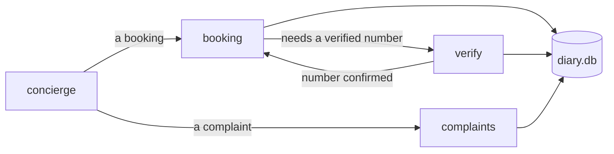

# Salon, as a graph

Sage and Stone, a hair salon's phone line, built on core. Four conversation
steps (front desk, verification, booking, complaints) are declared in
`salon/agent.yaml`. Each step is one agent. The application, not the model,
decides what is written to the diary. The root [README](../../README.md)
explains how core works, with this salon as its running example.

## What happens on a call



1. The front desk (`concierge`) hears what the caller wants and hands them on.
2. Booking needs a verified phone number, so the graph puts `verify` first.
   Verify asks for the number, or reads the caller ID back, in fixed words.
3. The caller confirms the number with a yes, or by saying the same number
   again. Code binds that answer to the exact read-back they heard in full,
   and looks them up. The graph then returns to booking.
4. Booking offers the diary's free times. When the caller picks one, code
   reads it back: *"Shall I book a haircut, Friday the 2nd at 9:00 AM?"*
5. Only a yes to that heard read-back writes the booking. The confirmation is
   said in the diary's own words.

The diary is one SQLite file that every worker shares. A database trigger
holds the one chair, and every write is keyed by its intent, so a lost answer
is never written twice.

## How to run it

You need **uv** (`brew install uv`, or https://docs.astral.sh/uv/ — it installs
the right Python itself, this project pins 3.14) and a `.env` at the repository
root holding the two keys in the root README. Nothing else.

One call, in the browser:

```bash
DELIVERY=simulated uv run bot.py
```

Then open **http://localhost:7860** and click connect. The browser transport
returns no playback marks, so `DELIVERY=simulated` lets an estimated playback
count as heard. Without it, no read-back can be approved.

Several phone calls at once, on one host:

```bash
DIARY_PATH=salon.db RUNNER_DB=runner.db uv run uvicorn server:app --workers 2 --port 7860
```

The runner admits at most five calls and answers busy past that. It is
qualified on one MacBook for five calls at once
([session-4c.md](../../docs/research/reusable-core/session-4c.md)). That is not
a production capacity claim. For live Coval calls on a real Twilio line, use
`coval_sim serve` in `../concierge-tools`, which starts this runner.

| Setting | What it does |
|---|---|
| `DELIVERY` | `marks` (default): only a returned Twilio mark counts as heard. `simulated`: an estimate counts too, for the browser or a transport with no marks |
| `CALLER_ID` | the number a call arrives with; read back and confirmed before it is trusted |
| `DIARY_PATH` | the shared diary file. Unset: a private file for this process only |
| `DIARY_CLOCK` | pins the salon's idea of now (ISO time), so "tomorrow" is the same day on every run |
| `MAX_CALL_SECONDS` | ends a call this long after it connects. 0, the default, never does |
| `VAD_STOP_SECS` | the voice detector's silence window, 0.3 s by default |
| `RUNNER_DB`, `MAX_CALLS` | the runner's call record, and its ceiling (5) |
| `CARRIER_NUMBER` | `1` offers the webhook's `From` as the caller's number. Off by default: on a shared test line every call comes from one number |

Turn taking is Pipecat's: Silero VAD with a 0.3 s silence window, and
smart-turn v3 with a 1.6 s ceiling on a turn it thinks is not finished.

## Results

On a real Twilio line, five calls at a time, every call after the Stage C
fixes booked correctly: 25 of 25. They were 10 normal callers, 10
interruptive callers, and 5 who said their number back after "no". Delivery
passed on all 25. From the caller going quiet to the bot's first audio, on
the call recordings, p50 was 2.6-2.7 s and p90 3.6-4.4 s. The full numbers are in the
root README's Evidence section.

## How to check it

```bash
uv run python -m tests                 # offline, no .env, no network
uv run ty check .
```

| Command | What it runs | Cost |
|---|---|---|
| `uv run python -m evals.load ramp --calls 1,2,5 --seconds 60 --workers 2 --out /tmp/load` | the real runner, 1 → 2 → 5 calls, with provider doubles and fake Twilio phones | free, offline |
| `uv run python -m evals.load faults --out /tmp/faults` | worker kills, a stale worker, overload and drain | free, offline |
| `uv run --env-file ../../.env python -m evals.calls` | the live text checkpoint, T1-T4, judged on the diary | billable |

The one-prompt baseline of the same salon is in `../salon-prompt`, and the
declarative Pipecat-flows build is in `../salon-pipecat-flows`. Coval calls,
`load_report` and the cost ledger that compare them are in
`../concierge-tools`.
