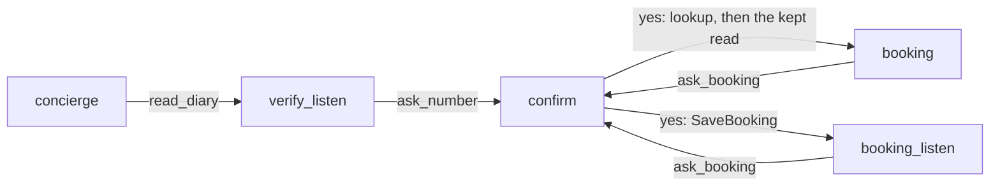

# The salon on declarative Pipecat flows

This folder is the salon built on Pipecat's own flows: a `FlowConfig` in
`flow.yaml`, joined to direct functions in `graph_salon/handlers.py`, run by
`FlowManager`. It keeps the harness's guarantees, written as plain
application code. It imports no `core` and no Pydantic AI.

The diary, receipts, phone shape, voice rules and knowledge in `salon/` are
copies of the salon's, as salon-prompt keeps them. The pipeline is the same
as the salon's `bot.py` (`use-cases/salon`). So a Coval run or a comparison with the ledger
(`concierge-tools/ledger.py`) measures the conversation layer. Two things
differ:

- The model is `gemini-3.1-flash-lite`, because Pipecat's Gemini service has
  problems with the harness's 3.5 flash lite.
- Smart-turn's silence fallback is 1.5 s, not Pipecat's 3 s
  (`TURN_STOP_SECS` in `bot.py`).

It answers one question from `UNMUTE_V1.md`: can native Pipecat do what the
typed-flow harness does? The research said "yes, with application code". This
is that application code.

## How to run it

From this folder:

```bash
uv run bot.py                           # voice, http://localhost:7860
uv run bot.py --port 7861               # when 7860 is taken
uv run python -m tests                  # offline checks, no model, no .env
```

`bot.py` finds the root `.env` by walking up from this folder.

## The files

| File | What it holds |
|---|---|
| `bot.py` | The entry point: SLNG STT and TTS, VAD and smart-turn, the transports, tracing, the Gemini service |
| `flow.yaml` | The graph, as a Pipecat `FlowConfig`: every node, and every move each tool may make |
| `prompts/*.yaml` | Each node's task messages, pulled in with `!include`. `actions.md` goes into the system instruction |
| `graph_salon/handlers.py` | One direct function per tool, `@tool(ArgsModel)` running the guarantees, and the `say` action |
| `graph_salon/flow.py` | Loads and checks `flow.yaml`, joins it to the handlers, gives each tool its Pydantic schema |
| `graph_salon/models.py` | Pydantic models: the call state, the proposal, the tool arguments, `Outcome` |
| `graph_salon/call.py` | `SalonCall`: the consent guards, the turn, the budget |
| `graph_salon/writes.py` | `Write.run`: the only path to the diary's writes |
| `graph_salon/speech.py` | The fixed lines, `ClaimFilter` and `EmptyReplyGuard` |
| `salon/` | Copies of the salon's diary, shapes, receipts and prompts. Change both, or the builds stop being comparable |
| `utils/observability.py` | Langfuse over OpenTelemetry, salon-prompt's copy |
| `tests/test_graph_salon.py` | The offline checks. |

## How a booking works



1. The caller asks for a haircut on Friday. The model on `concierge` calls `read_diary(day='Friday', service='haircut')`.
2. Nobody is identified yet. Code keeps the read, and returns `next: verify_listen` with a fixed line:
   "Could I take your phone number, please?". No model request runs until the caller answers.
3. The caller gives the number. `ask_number` stores a `Proposal`, with the read-back worded by code, and goes to `confirm`.
   `confirm` speaks it and does not run the model.
4. The caller answers. The only tool on `confirm` is `answer(reply)`, with the enum `yes`, `no`, `change` or `other`.
   It never takes booking details.
5. On `yes`, `Write.run` checks the proposal, calls the diary once, validates the answer into a receipt, and commits it.
6. Code then runs the kept diary read itself and moves to `booking`, with the free times in the result.
   The model speaks once, to offer them.
7. A picked time goes through `ask_booking` and `confirm` the same way. After the booking, `booking_listen` speaks the
   receipt and waits. No model request follows.

## How it uses Pipecat flows

- **The config owns the moves.** Every tool returns `(result, TRANSITION_IN_YAML)`, and a branch table on
  the field `next` lists that tool's legal moves. A name the table does not list moves nowhere.
- **Pipecat checks the graph at load time.** `FlowConfig` is Pydantic, and it checks that every destination
  is a node. `Flow` checks that every tool and action handler exists. `graph_salon/flow.py` adds two checks:
  the nodes match `NodeName`, and every tool has an argument model.
- **Who speaks next is a node.** `respond_immediately` and `pre_actions` are fixed per node. So each step has two
  nodes: `booking` (the model speaks on entry) and `booking_listen` (code has just spoken, so wait for the caller).
- **State carries what code decided.** `{{ question }}` and `{{ facts }}` in the prompts, and `say` for the `say`
  action, come from `flow_manager.state`. Every tool sets them before it returns. `{{ role }}` and
  `{{ diary_rules }}` are set once.
- **Where Pipecat stops, code takes over:**
  - Pipecat's `tts_say` holds the node change until an `ActionFinishedFrame` reaches the end of the pipeline, with no
    timeout. A caller who cuts in drops that frame, so the node change never completes. In trace 2b75413c the call
    stayed on `booking` without `answer`, and the model invented a read-back and a receipt. Every listening node
    speaks through a custom `say` action instead, which nothing waits for.
  - Direct functions send `Literal` arguments with no enum. `flow.typed` replaces each schema with the Pydantic one.
  - Gemini can return an empty reply, and Pipecat does not retry it. `EmptyReplyGuard` runs the model again once,
    then speaks a fixed line.
  - When a tool fails, Pipecat asks the model to explain the error. `@tool` speaks a fixed line instead.

## Where each guarantee lives

| Guarantee | Where |
|---|---|
| Consent is owned by code | `SalonCall.approve`: a proposal exists, the yes came in a later caller turn, from the same verified number. The proposal is taken off the table, so it authorises once. |
| One action per reply | `SalonCall.claim`: a second action on the node the last one ran on, with no move in between, is the same reply. Pipecat moves only after every call in a reply has finished. |
| Turn budget | `SalonCall.over_budget`: eight tool calls per caller turn, like the harness's `TurnBudget`. Past that, the node's `_listen` twin speaks a fixed line. |
| Prerequisite and resume | `handlers.entering`. A carrier number is read back by code, and with none, code asks for the number. A diary read asked for before verification is run by code after it. |
| Tool arguments validated | Each tool's arguments are a Pydantic model. Its JSON schema is what the model sees. `model_validate` runs before anything else. |
| Service answers validated | Every diary answer is validated into `salon/models/receipts.py` before a field is read. |
| Done only on evidence | `CallState.appointment` and `CallState.complaint` hold receipts, never flags. |
| State replaced whole | `SalonCall.commit`: one validated, frozen `CallState`, or nothing. |
| Speech from receipts | `speech.py` words every read-back and receipt, in the harness's words. The tests check they stay the same. |
| No unbacked claims | `ClaimFilter` drops a first-person claim unless a receipt landed this turn, and always drops a model copy of a line only code says (`SCRIPTED`), with the rest of that reply. |
| No silent turn | `EmptyReplyGuard`: an empty reply, or one the filter emptied, is run again once, then a fixed line. A reply the caller cut short by talking on is not empty: their turn brings the next one. |
| Each answer spoken once | A second `answer` to a question another reply already settled returns `NO_RESPONSE`: no move, no model run. |
| No frozen node change | The `say` action. The tests enter every node on a pipeline that never runs, where `tts_say` would hang. |
| A write survives a barge-in | Pipecat's default `cancel_on_interruption=False`, and each write carries the proposal's token, so a retry writes once. |
| Trace parity | `Write.run` leaves the harness's `write` span, so the ledger matches each write to its question. |

## What is left out, on purpose

- Held approval across a detour. A detour drops the proposal, and the caller is asked again.
- Joining a caller's paused speech into one turn. Pipecat's own endpointing decides.
- Zero-model approvals. Each approval costs one `confirm` request. The ledger shows the price.
- The complaint excerpt check. The harness refuses a summary that does not quote the caller. Here the prompt asks for it.
- Rotating receipt lines. Each receipt has one wording, the first of the harness's.

## What came from the generated example

The starting point was the generated Pipecat salon in
`unmute_cli/examples/salon-concierge/build/pipecat`. It had 4,000 lines in one
`bot.py`, four identical 643-line tool files, three copies of the verify
sub-flow, and a model-set `confirmed=True` flag as consent. This folder keeps
its idea (flow nodes, code-spoken fixed lines, `respond_immediately=False`)
and drops the rest: the workers API with two agents, the llama-index
retrieval, the dev metrics feed and the tracing patches.
